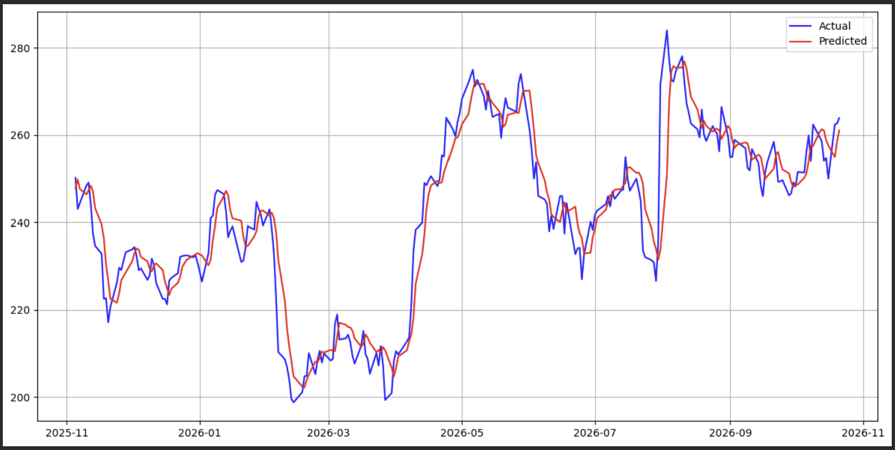
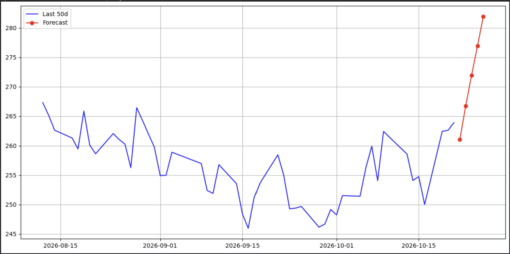
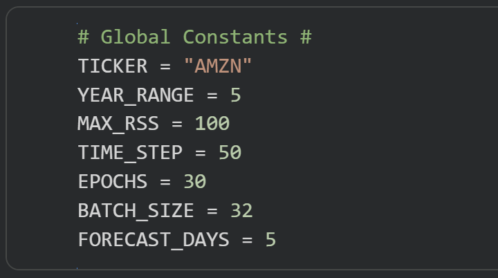

# Stock Price Forecasting With Sentiment Analysis #

## Forecasting stock prices using FinBERT for sentiment analysis and Bidirectional GRUs for price prediction ##

This project uses historical market data and financial news sentiments to predict stock price movements. The notebook implements the following:
* Collecting and preprocessing stock price and financial news data from Yahoo Finance, handling missing values, normalizing prices, and preparing time-series data for model training
* Using FinBERT to extract sentiment scores from stock-related news, combining sentiment scores with price data using sliding-window sequences
* Training a Bidirectional GRU to forecast stock prices from sequential price and sentiment features, evaluating predictive performance using RMSE and MAE

## Model Validation Example ##

## Forecast Example ##

## How To Use This Notebook ##
Under "Global Constants," input the ticker you want to forecast and click "run all."

YEAR_RANGE is the number of years of market data to collect.

TIME_STEP is the number of days in the sliding window
